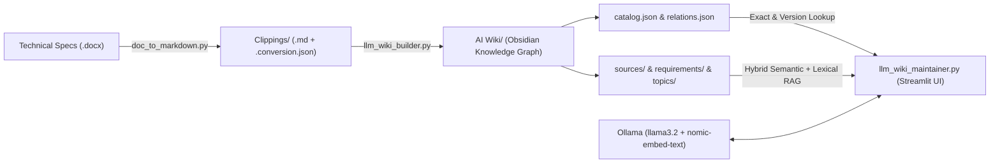

# LLM+WIKI

> **GitHub Repository Description:**  
> *A local, deterministic, revision-aware RAG and Obsidian Wiki system for technical specifications. Converts DOCX specifications into structured Markdown, builds an indexed requirement catalog and interconnected Obsidian knowledge graph, and provides a hallucination-free Streamlit Q&A assistant powered by Ollama and LangChain.*

---

## Overview

**LLM+WIKI** is an end-to-end local knowledge base pipeline designed for authoring, indexing, comparing, and querying complex technical specifications and requirement documents inside an **Obsidian** vault.

Unlike generic RAG pipelines that split documents blindly and risk hallucinating normative statements, **LLM+WIKI** combines:
1. **Revision-Aware DOCX Conversion (`doc_to_markdown.py`)**: Extracts requirements (`R x.y.z`), tables, headings, and Word tracked changes (insertions, deletions, and voided requirements) into clean Obsidian Markdown along with a JSON conversion quality report.
2. **Deterministic Wiki & Graph Builder (`llm_wiki_builder.py`)**: Deterministically ingests Markdown sources without LLM hallucinations during indexing—generating chunk pages, atomic requirement pages, topic/section hubs, a structured `catalog.json`, cross-document `relations.json`, and an Obsidian `index.md`.
3. **Strict Evidence-Based Q&A Assistant (`llm_wiki_maintainer.py`)**: A Streamlit web interface powered by local **Ollama** models (`llama3.2` + `nomic-embed-text`) featuring exact catalog lookup, multi-version specification comparison, hybrid semantic + lexical retrieval, and strict normative keyword preservation (`SHALL`, `SHOULD`, `MAY`, `MUST`, `VOID`).

---

## Architecture



---

## Key Features

- **Tracked-Changes & Revision Awareness**: Detects Word `<w:ins>` and `<w:del>` revisions, preserving visibility into deleted requirement bodies and `VOID` statuses across specification versions.
- **Zero-Hallucination Ingestion**: The wiki builder (`v3.2`) is 100% deterministic—no LLM calls are made while splitting documents, extracting requirement IDs (`R x.y.z`), or building the catalog.
- **Hybrid Multi-Mode Retrieval (`v4.3`)**:
  - **Catalog Exact Lookup**: Instant, exact resolution when querying specific requirement IDs (e.g., `R 3.2.1`), including version-specific queries.
  - **Cross-Version Comparison**: Automatically detects and compares requirement evolution across specification versions (e.g., `V0.1` vs `V0.4`).
  - **Semantic + Lexical Fallback**: Combines `nomic-embed-text` vector similarity with domain-specific phrase/term boosting and automatic lexical fallback.
- **Strict Normative Fidelity**: System prompts and guardrails enforce RFC-style normative keywords (`MUST`, `SHALL`, `SHOULD`, `MAY`, `OPTIONAL`, `VOID`) without altering mandatory vs. recommended semantics.
- **Native Obsidian Integration**: Generates deep `obsidian://open?vault=...` links and wikilinks so every cited source or requirement opens directly in Obsidian.

---

## Repository Structure

```text
LLM+WIKI/
├── doc_to_markdown.py       # Step 1: Revision-aware DOCX to Obsidian Markdown converter
├── llm_wiki_builder.py      # Step 2: Deterministic Obsidian Wiki & catalog builder
├── llm_wiki_maintainer.py   # Step 3: Streamlit RAG assistant & diagnostic UI
├── requirements.txt         # Python dependencies
├── Clippings/               # Converted Markdown specifications & conversion quality reports
├── AI Wiki/                 # Generated Obsidian Wiki (index, catalog, sources, requirements, topics)
└── Welcome.md               # Obsidian vault welcome note
```

---

## Prerequisites

1. **Python 3.10+**
2. **[Ollama](https://ollama.com/)** installed and running locally with the default models pulled:
   ```bash
   ollama pull llama3.2:latest
   ollama pull nomic-embed-text:latest
   ```
3. **[Obsidian](https://obsidian.md/)** (optional, for browsing the generated `AI Wiki` graph and opening source links).

---

## Installation

Clone the repository and install the Python dependencies:

```bash
git clone https://github.com/<your-username>/LLM-WIKI.git
cd LLM-WIKI
python -m venv .venv
# Activate virtual environment:
# macOS / Linux:
source .venv/bin/activate
# Windows:
.venv\Scripts\activate

pip install -r requirements.txt
```

---

## Usage

### 1. Convert a DOCX Specification to Markdown
Convert a Word `.docx` technical specification into revision-aware Markdown inside `Clippings/`:

```bash
python doc_to_markdown.py "/path/to/specification.docx"
```
*(Optional)* Specify a custom output directory with `--output-dir`:
```bash
python doc_to_markdown.py "/path/to/specification.docx" --output-dir "./Clippings"
```

### 2. Build the Obsidian Wiki & Catalog
Run the deterministic builder to process all `.md` files in `Clippings/` and populate `AI Wiki/`:

```bash
python llm_wiki_builder.py
```
This generates:
- `AI Wiki/index.md` — Global Obsidian index
- `AI Wiki/catalog.json` — Structured requirement catalog
- `AI Wiki/relations.json` & `build_report.json` — Cross-references and build metrics
- `AI Wiki/sources/`, `AI Wiki/requirements/`, `AI Wiki/sections/`, `AI Wiki/topics/` — Interlinked Markdown notes

### 3. Launch the Streamlit Assistant
Start the interactive web interface to query requirements, compare versions, and inspect retrieval diagnostics:

```bash
python -m streamlit run llm_wiki_maintainer.py
```

---

## Configuration

All three scripts automatically default to the repository directory as the Obsidian vault root (`OBSIDIAN_DIR`). You can override settings via environment variables if needed:

| Environment Variable | Default | Description |
| :--- | :--- | :--- |
| `OBSIDIAN_DIR` | Repository root directory | Path to the Obsidian vault containing `Clippings/` and `AI Wiki/` |
| `LLM_MODEL` | `llama3.2:latest` | Ollama chat model used by `llm_wiki_maintainer.py` |
| `EMBED_MODEL` | `nomic-embed-text:latest` | Ollama embedding model used for semantic retrieval |

---

## License

This project is provided for technical documentation management, requirement engineering, and local AI knowledge base workflows.
